

  


  


  


  
  


  <a href="https://uniconv-psi.vercel.app/"></a>
  <a href="https://acad-ops.vercel.app/"></a>
  <a href="https://noc-portal-self.vercel.app/"></a>
  <a href="https://mitm-placepro.vercel.app/"></a>
  <a href="https://www.mitmresearch.in/"></a>
  
  <a href="https://eventflow-indol.vercel.app/"></a>
  <a href="https://petcommunity-puce.vercel.app/"></a>
  
  <a href="https://zylorun-five.vercel.app/"></a>


  
  

  


  
  
  
  
  

  

